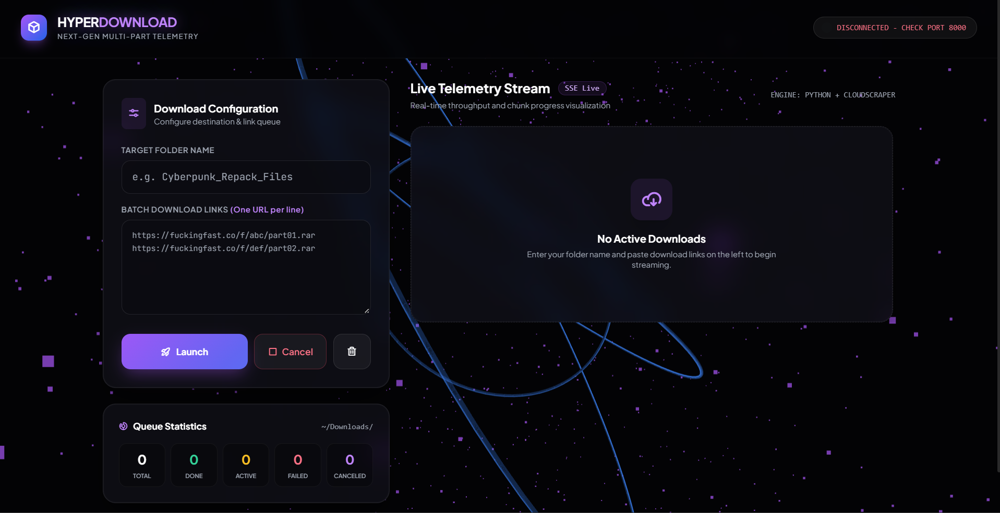

# 🚀 HyperDownload: Next-Gen Multi-Part Downloader

A high-performance, local web application featuring a stunning **React-style glassmorphism UI**, **Three.js 3D telemetry background**, and **GSAP animations**, powered by a robust **Python FastAPI** backend designed to bypass Cloudflare and stream multi-part downloads directly into your local `Downloads` directory.

---

## 📸 Dashboard Preview



---

## ✨ Key Features

- **Immersive 3D Telemetry Background (`Three.js`)**: Features an interactive 3D particle field and orbiting geometric wireframe rings that react to mouse parallax.
- **Sleek Cyber-Neon Glassmorphism UI (`Tailwind CSS` & custom CSS)**: Modern dark-mode interface with frosted glass panels, glowing accents, and high-contrast typography (`Plus Jakarta Sans` & `JetBrains Mono`).
- **Smooth Animations (`GSAP`)**: Fluid card entry transitions, spring-physics progress bars, and reactive status badges.
- **Cloudflare Bypass (`cloudscraper`)**: Automatically handles Cloudflare protection, fetches download triggers (`/go` endpoints), and extracts real CDN redirect URLs.
- **Real-Time SSE Telemetry (`Server-Sent Events`)**: Streams live progress percentages, download speeds (MB/s), and queue stats from Python to the browser instantly.
- **Instant Cancellation**: Dedicated Cancel button to instantly abort active downloads, clean up partial files, and skip upcoming queue items.
- **Zero Browser Popups**: Files download directly in chunks straight to `C:\Users\<username>\Downloads\<Folder Name>\`.

---

## 🛠️ Tech Stack

### **Backend**
* **Python 3.11+**
* **FastAPI** & **Uvicorn** (REST API & Real-time SSE streaming)
* **cloudscraper** (Cloudflare challenge bypass)
* **asyncio** (Non-congested asynchronous download queuing)

### **Frontend**
* **Single-File Architecture (`index.html`)** with zero build-step complexity.
* **Three.js** (WebGL 3D background canvas)
* **GSAP (GreenSock Animation Platform)** (UI animations)
* **Tailwind CSS** & **Phosphor Icons**

---

## ⚙️ Installation & Setup

### 1. Prerequisites
Ensure you have Python 3.11+ installed on your system.

### 2. Install Dependencies
Open your terminal in the project directory and install the required Python packages:
```bash
pip install fastapi uvicorn cloudscraper
```

### 3. Run the Application
Start the FastAPI server:
```bash
python app.py
```

### 4. Open in Browser
Open your browser and navigate to:
```text
http://localhost:8000
```

---

## 📖 How to Use

1. **Enter Folder Name**: Type a name for your download batch (e.g., `Cyberpunk_Repack_Files`). A corresponding folder will be created inside your system's `Downloads` directory.
2. **Paste Links**: Paste your multi-part download links (one per line) in the batch textarea.
3. **Initialize Queue**: Click **Launch**.
4. **Monitor Live Telemetry**: Watch the 3D background pulse as real-time progress bars, throughput speeds, and status badges (`WAITING`, `DOWNLOADING`, `DONE`, `CANCELED`) update live via Server-Sent Events.
5. **Cancel Anytime**: Click **Cancel** to abort active and upcoming downloads instantly.

---

## 🛡️ Architecture & Data Flow

```
┌────────────────────────────────────────────────────────┐
│                   Web Browser                          │
│             (http://localhost:8000)                    │
│   ┌────────────────────────────────────────────────┐   │
│   │  • Three.js Interactive 3D Canvas Background   │   │
│   │  • Glassmorphic Queue Dashboard & Live Cards   │   │
│   │  • GSAP Animated Progress & Throughput Trackers│   │
│   └───────▲────────────────────────────┬───────────┘   │
│           │                            │               │
│  HTTP POST│                            │ SSE Stream    │
│  (Queue)  │                            │ (/api/progress│
│           │                            ▼               │
┌───────────┴────────────────────────────┴───────────────┐
│                 Python FastAPI Backend                 │
│   • Queue Manager & Concurrency (asyncio)              │
│   • Cloudflare Bypass (`cloudscraper`)                 │
│   • Chunked File Streamer & Progress Broadcast         │
└──────────────────────────┬─────────────────────────────┘
                           ▼
             ┌───────────────────────────┐
             │   Local File System       │
             │   ~/Downloads/<Folder>/   │
             └───────────────────────────┘
```

---

## 📄 License
This project is open-source and intended for educational and personal workflow optimization.
